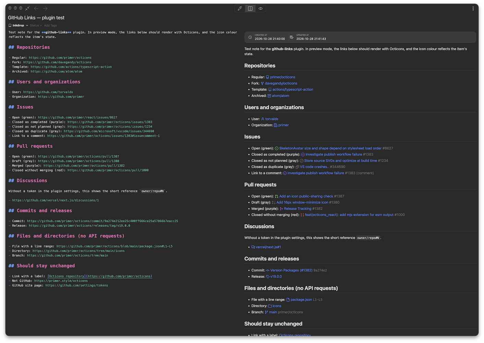

# github-links

An [Inkdrop](https://www.inkdrop.app) plugin that renders bare GitHub URLs in the note preview as
rich references: an [Octicon](https://primer.style/octicons), the item's title and its state,
fetched from the GitHub API.



Paste `https://github.com/primer/octicons/issues/1383` into a note, and the preview shows
"Investigate publish workflow failure #1383" with a purple closed-issue icon instead of the raw URL.
Icons and colours follow the item's state as on github.com, so open issues and merged pull requests
can be told apart at a glance. Only the preview changes; the Markdown source stays as you wrote it.

## Contents

- [Features](#features)
- [Installation](#installation)
- [Usage](#usage)
- [Configuration](#configuration)
- [Styling](#styling)
- [Development](#development)
- [License](#license)

## Features

| Link                 | Example                                               | Rendered as                                                             |
| -------------------- | ----------------------------------------------------- | ----------------------------------------------------------------------- |
| Repository           | `github.com/primer/octicons`                          | `owner/repo`; icon for public, private, fork, template or archived      |
| User or organization | `github.com/torvalds`                                 | Login; person or organization icon                                      |
| Issue                | `…/issues/1383`                                       | Title and number; open, closed as completed, not planned or duplicate   |
| Pull request         | `…/pull/1387`                                         | Title and number; open, draft, merged or closed                         |
| Discussion           | `…/discussions/1`                                     | Title and number; open, resolved, outdated or duplicate (needs a token) |
| Commit               | `…/commit/9a274e2`, `…/pull/1387/commits/9a274e2`     | First line of the message and the short SHA                             |
| Release              | `…/releases/tag/v19.0.0`                              | Release name                                                            |
| File or directory    | `…/blob/main/package.json#L1-L5`, `…/tree/main/icons` | Path and line range, without an API request                             |
| Branch or tag        | `…/tree/main`                                         | Ref name and repository, without an API request                         |

Icon colours match github.com: green for open, purple for completed, merged or resolved, red for
pull requests closed without merging, and gray for drafts and for items closed as not planned,
duplicate or outdated.

Hovering a link shows more detail, such as the reference and state of an issue, a repository's
description or the full commit message.

## Installation

Requires Inkdrop 6.1.3 or later.

```sh
ipm install github-links
```

See [Extend Inkdrop with plugins](https://docs.inkdrop.app/manual/extend-inkdrop-with-plugins) for
other ways to install.

Public repositories work without any setup. To link to private repositories or discussions, or if
you reach the limit of 60 requests per hour, add a [GitHub access token](#configuration).

## Usage

Write a GitHub URL on its own, or as a link whose text is the URL itself, and open the preview:

```markdown
The fix landed in https://github.com/primer/octicons/pull/1382.

<https://github.com/primer/octicons/issues/1383#issuecomment-1>
```

A link with its own label keeps it: `[Octicons repository](https://github.com/primer/octicons)`
still reads "Octicons repository".

- Links to a comment (`#issuecomment-…`, `#discussioncomment-…`, review comments) get a "(comment)"
  suffix.
- Until the data arrives, or if the request fails, the link shows a short reference such as
  `primer/octicons#1383`. User and organization links stay plain URLs until GitHub confirms that
  the account exists.
- github.com pages that are not accounts or repositories, such as
  `https://github.com/settings/tokens`, are left unchanged.
- When a note is exported or printed, links are left as plain URLs.
- Responses are cached, so editing a note does not repeat requests. To fetch everything again, run
  **Plugins › GitHub Links › Refresh GitHub Links** (`github-links:refresh`).
- If the API rate limit is reached, a notification says when the links will be updated again.

## Configuration

| Setting                  | Default | Description                                                                                                               |
| ------------------------ | ------- | ------------------------------------------------------------------------------------------------------------------------- |
| GitHub access token      | empty   | Optional. Raises the rate limit from 60 to 5,000 requests per hour. Required for private repositories and discussions.    |
| Show repository name     | off     | Show `owner/repo#123` instead of `#123` next to titles. Commits, releases and file paths get the repository name as well. |
| Cache lifetime (minutes) | 15      | How long fetched data is reused before it is requested again. The minimum is 1.                                           |

A [fine-grained personal access token](https://docs.github.com/en/authentication/keeping-your-account-and-data-secure/managing-your-personal-access-tokens)
with read-only access is enough. The token is stored in plain text in Inkdrop's config file, so do
not give it write permissions. If GitHub rejects the token, for example after it expires, Inkdrop
shows a warning.

## Styling

Rendered links can be restyled from your `styles.less`. Each one keeps its `<a>` element and gets
these classes:

| Selector                                          | Applies to                                                                                    |
| ------------------------------------------------- | --------------------------------------------------------------------------------------------- |
| `.github-link`                                    | Every rendered link                                                                           |
| `.github-link-<kind>`                             | Link type: `user`, `repo`, `issue`, `pull`, `discussion`, `commit`, `release`, `blob`, `tree` |
| `.is-open`, `.is-done`, `.is-closed`, `.is-muted` | State of issues, pull requests and discussions                                                |
| `.is-loading`                                     | Links whose data has not arrived yet                                                          |
| `.github-link-icon`                               | The Octicon                                                                                   |
| `.github-link-title`                              | The title                                                                                     |
| `.github-link-suffix`                             | Number, SHA, line range or repository after the title; `.is-mono` when set in monospace       |

For example, to hide the numbers after issue and pull request titles:

```less
.github-link-issue .github-link-suffix,
.github-link-pull .github-link-suffix {
  display: none;
}
```

## Development

Requires Node.js and [pnpm](https://pnpm.io).

```sh
pnpm install
pnpm dev       # rebuild into lib/ on change
ipm link       # symlink into your Inkdrop data directory for local testing
```

Before committing, run the linter and formatter and check that the production build succeeds:

```sh
pnpm lint      # oxlint
pnpm format    # oxfmt
pnpm build     # minified build into lib/
```

| File                      | Responsibility                                                                  |
| ------------------------- | ------------------------------------------------------------------------------- |
| `src/index.ts`            | Plugin entry: settings, the refresh command, notifications                      |
| `src/GithubLink.tsx`      | Replaces the preview's link component and renders GitHub URLs                   |
| `src/parse.ts`            | Turns a github.com URL into a typed reference                                   |
| `src/github.ts`           | GitHub API client: REST through Octokit, GraphQL for discussions, rate limiting |
| `src/store.ts`            | Response cache shared by all links in the preview                               |
| `src/describe.ts`         | Chooses the icon, title, state and tooltip for a link                           |
| `styles/github-links.css` | Icon size and state colours                                                     |

## License

[MIT](https://opensource.org/license/mit)
